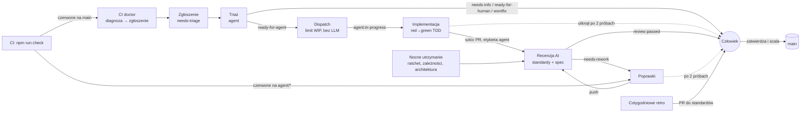

# Software Factory Starter

Przykładowe repozytorium z kompletną **fabryką oprogramowania AI** w modelu „najpierw hamulce, potem
prędkość”. Mała biblioteka do faktur w TypeScript (`src/`) jest tu tylko materiałem, na którym fabryka
pracuje: wytwarza zmiany, debuguje awarie CI i stale ulepsza kod oraz samą siebie.

Stos: **GitHub Issues + etykiety** (system zgłoszeń), **GitHub Actions** (orkiestrator i jednorazowy
runner), **Claude Code** przez `anthropics/claude-code-action@v1` (agent).

> Pliki czytane przez agentów (`AGENTS.md`, skille, standardy) są po angielsku, bo tak agenci działają
> najpewniej. Ten README jest dla ludzi.

## Jak to działa



Zasada: **każdy wyzwalacz to akcelerator, więc najpierw są hamulce.** Przebieg nigdy nie czeka na
człowieka. Kończy się, zmienia etykietę, a ta zmiana uruchamia kolejny przebieg.

## Co jest w środku

### Hamulce (jakość, której agent nie ominie)

| Element                     | Plik                                                     | Co robi                                                                                                                                                             |
| --------------------------- | -------------------------------------------------------- | ------------------------------------------------------------------------------------------------------------------------------------------------------------------- |
| Jedna komenda kontroli      | `package.json` → `npm run check`                         | typy, ESLint, Prettier, testy Vitest, ratchet testów                                                                                                                |
| CI jako prawdziwa bramka    | `.github/workflows/ci.yml`                               | ta sama kontrola w CI, ustaw ją jako **wymaganą**                                                                                                                   |
| Ratchet testów              | `scripts/check-test-ratchet.mjs`, `tests/.baseline.json` | liczba testów nie może spaść; blokuje `.skip`, `.only`, `expect(true)`                                                                                              |
| Ratchety tylko w górę       | `scripts/check-ratchets.mjs`                             | PR nie może poluzować lint-ratchetu ani bazowej liczby testów                                                                                                       |
| Granica architektury        | `eslint.config.mjs`                                      | domena nie importuje `node:*` (ADR 0003)                                                                                                                            |
| Hooki agenta                | `.claude/settings.json`, `scripts/hooks/`                | blokują `--no-verify`, force-push, kasowanie testów, czytanie sekretów, edycję plików fabryki; hook Stop nie pozwala skończyć, dopóki `npm run check` jest czerwone |
| Lokalny hook                | `.husky/pre-commit`                                      | `npm run check` przed commitem                                                                                                                                      |
| Właściciele                 | `.github/CODEOWNERS`                                     | testy i pliki fabryki wymagają recenzji człowieka                                                                                                                   |
| Szablon PR                  | `.github/pull_request_template.md`                       | Podsumowanie / Dowód / Ryzyko scalenia                                                                                                                              |
| Testy holdout (opcjonalnie) | job `holdout` w `ci.yml`                                 | ukryte scenariusze z prywatnego repo, których agent nie widzi                                                                                                       |

### Wiedza (czego agent się uczy z repo)

`AGENTS.md` (krótki, pisany ręcznie; `CLAUDE.md` go importuje), `GLOSSARY.md`, `CODING_STANDARDS.md`,
`docs/adr/`, `.out-of-scope/`, `docs/factory/` (zadania, etykiety, limity).

### Zadania fabryki

| Obszar        | Zadanie                                                       | Workflow                | Skill        |
| ------------- | ------------------------------------------------------------- | ----------------------- | ------------ |
| Wytwarzanie   | triaż zgłoszeń                                                | `agent-triage.yml`      | `/triage`    |
|               | dispatch z limitem WIP (bez LLM)                              | `agent-dispatch.yml`    | —            |
|               | implementacja (TDD → szkic PR)                                | `agent-implement.yml`   | `/fix-issue` |
|               | recenzja w świeżym kontekście                                 | `agent-review.yml`      | `/review`    |
|               | poprawki (maks. 2 próby)                                      | `agent-rework.yml`      | `/rework`    |
| Debugowanie   | diagnoza czerwonego CI na `main` → zgłoszenie                 | `agent-ci-doctor.yml`   | `/ci-doctor` |
|               | czerwone CI na PR agenta → poprawki                           | `agent-ci-doctor.yml`   | `/rework`    |
|               | pomoc na żądanie (`@claude` w komentarzu)                     | `agent-assist.yml`      | —            |
| Ciągły rozwój | nocne utrzymanie: lint-ratchet, zależności, skan architektury | `agent-maintenance.yml` | `/maintain`  |
|               | cotygodniowe retro → PR do standardów i skilli                | `agent-retro.yml`       | `/retro`     |
|               | cotygodniowe metryki (bez LLM)                                | `factory-metrics.yml`   | —            |

## Uruchomienie (ok. 30 minut)

1. **Utwórz repozytorium** z tych plików i wypchnij na `main`. Lokalnie: `npm ci && npm run check`.
2. **Etykiety:** Actions → „factory: setup labels” → Run workflow.
3. **Reguły gałęzi `main`** (Settings → Rules → Rulesets): wymagany status check `check` (z workflow CI),
   wymagany PR z 1 zatwierdzeniem, wymagana recenzja code ownerów, zakaz force-push. W
   `.github/CODEOWNERS` wpisz swój zespół zamiast `@your-org/maintainers`.
4. **GitHub App dla fabryki.** Zdarzenia z domyślnego `GITHUB_TOKEN` nie uruchamiają kolejnych
   workflow, więc łańcuch zadań wymaga aplikacji. Utwórz GitHub App z uprawnieniami: Contents (RW),
   Issues (RW), Pull requests (RW), Actions (R), Checks (R). Zainstaluj ją na repo.
   - zmienna repo `FACTORY_APP_ID`, sekret `FACTORY_APP_PRIVATE_KEY`,
   - zmienna `FACTORY_BOT_LOGIN`, np. `moja-fabryka[bot]` (agent może być uruchamiany przez tego bota).
5. **Klucz modelu:** sekret `ANTHROPIC_API_KEY`. Najlepiej klucz organizacji z limitem wydatków
   w Console, nie prywatny token. Wolisz subskrypcję Claude Pro/Max? Zapisz token z
   `claude setup-token` jako sekret `CLAUDE_CODE_OAUTH_TOKEN` i w workflowach z
   `claude-code-action` zamień `anthropic_api_key` na
   `claude_code_oauth_token: ${{ secrets.CLAUDE_CODE_OAUTH_TOKEN }}`. Limity użycia są wtedy
   wspólne z Twoją pracą w Claude Code, a token wygasa po około roku.
6. **Włącz fabrykę:** zmienna `FACTORY_ENABLED=true`. To jest też **wyłącznik awaryjny**: ustaw
   cokolwiek innego, a żaden agent się nie uruchomi.
7. **Przypnij akcje do SHA** (zalecane): `pinact run` albo ręcznie; Dependabot (`.github/dependabot.yml`)
   będzie je odświeżał.
8. **Wypróbuj:** załóż zgłoszenia z `docs/examples/sample-issues.md` (jest wśród nich prawdziwy błąd
   w `formatCents(-50)`).

Opcjonalnie: `FACTORY_MAX_WIP` (domyślnie 2), `FACTORY_MAX_REWORK` (domyślnie 2), `FACTORY_MODEL`,
`HOLDOUT_REPO` + sekret `HOLDOUT_TOKEN`.

## Bezpieczeństwo i koszty, zaprojektowane od początku

- **Treść zgłoszeń i komentarzy to wrogie dane.** Skille mówią to wprost, a hooki egzekwują to
  deterministycznie, niezależnie od tego, co ktoś wpisze w zgłoszenie.
- **Agenta uruchamiają tylko osoby z prawem zapisu** (domyślnie w `claude-code-action`) oraz bot
  fabryki. Zgłoszenia od osób z zewnątrz czekają, aż maintainer ponownie doda `needs-triage`.
- **Minimalne uprawnienia:** `permissions: {}` na górze każdego workflow, zapis tylko przez token
  aplikacji. Każde zadanie ma jawną listę narzędzi (`--allowedTools`). Triaż i recenzja nie mogą
  wypychać kodu.
- **Bez zabójczej trójcy:** agent nie ma narzędzi sieciowych (`curl`/`wget` zablokowane) ani dostępu
  do produkcji, a sekrety są poza jego zasięgiem.
- **Agent nie scala.** `gh pr merge` jest zablokowany, PR-y są szkicami, zatwierdza człowiek.
- **Limity kosztów poza agentem:** `--max-turns`, `--max-budget-usd`, `timeout-minutes`,
  `concurrency` i globalny limit WIP w dispatchu.
- **Agent nie zmienia własnych hamulców:** workflow, ustawienia, hooki i ratchety są chronione
  hookiem i CODEOWNERS.

## Jak dodawać gazu

Zacznij od `FACTORY_MAX_WIP=1` i 1–2 zgłoszeń dziennie. Co tydzień czytaj zgłoszenie „Factory
metrics”. Podnoś limit dopiero wtedy, gdy odsetek scaleń, pierwsze przejście recenzji i zielone CI
na `main` trzymają poziom. Pamiętaj, że wąskim gardłem jest przepustowość recenzji, nie tokeny.
Każdy błąd złapany przez człowieka zamieniaj w nową kontrolę (test, regułę lint, ratchet). Retro
podpowiada, co warto zautomatyzować.

## Struktura

```
.claude/            settings.json (uprawnienia + hooki), skills/ (triage, fix-issue, review, rework, ci-doctor, maintain, retro)
.factory/           lint-ratchet.json
.github/            workflows/ (CI + 11 workflow fabryki), ISSUE_TEMPLATE/, labels.json, CODEOWNERS, PR template
docs/               adr/, factory/ (zadania, etykiety), examples/sample-issues.md
scripts/            hooks/, check-test-ratchet.mjs, check-ratchets.mjs, factory-metrics.mjs
src/, tests/        przykładowa aplikacja i jej testy
AGENTS.md, CLAUDE.md, GLOSSARY.md, CODING_STANDARDS.md
```

## Uwagi

- Parametry `claude-code-action` (`prompt`, `claude_args`, `github_token`, `allowed_bots`) i flagi CLI
  (`--max-turns`, `--max-budget-usd`, `--allowedTools`) odpowiadają dokumentacji z października 2026.
  Sprawdź je w aktualnym README akcji, zanim włączysz fabrykę.
- Workflow przeszły `actionlint`, a kontrola `npm run check` przechodzi lokalnie. Pełnego łańcucha
  z prawdziwą aplikacją GitHub i kluczem API nie dało się tu uruchomić: pierwsze przebiegi obserwuj
  ręcznie.
